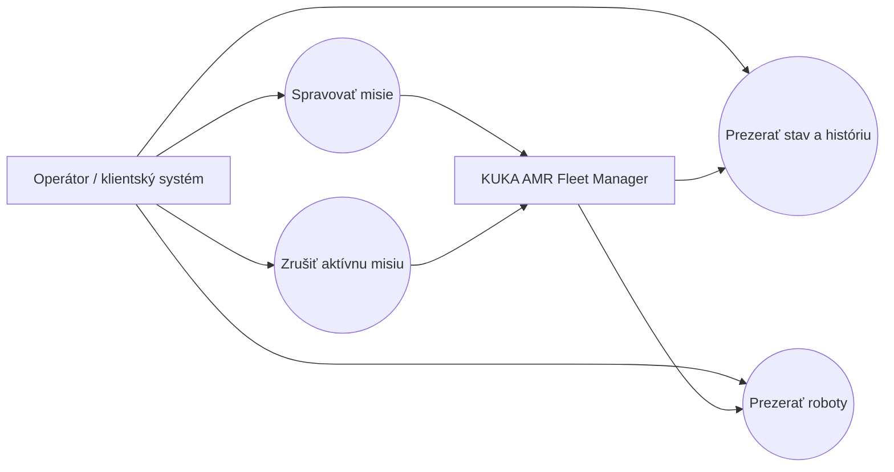
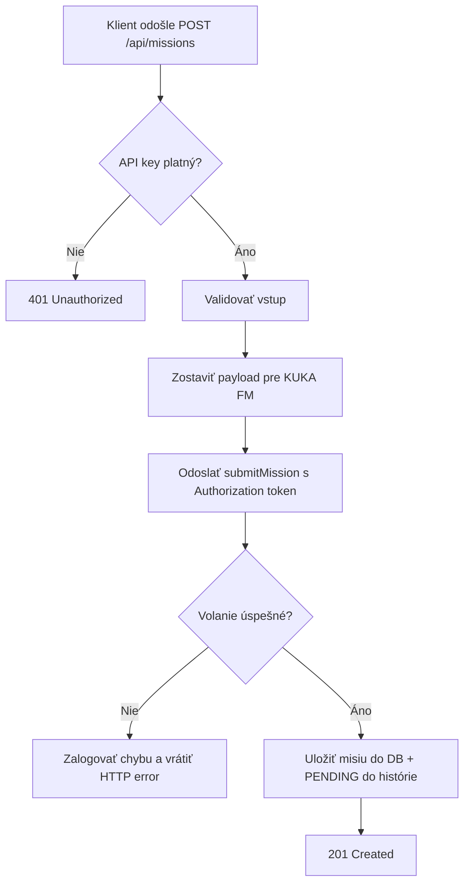
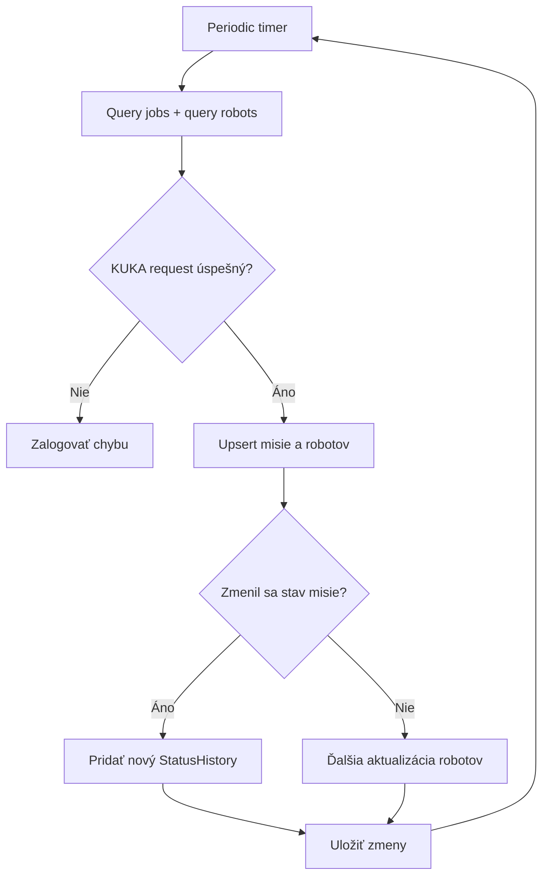
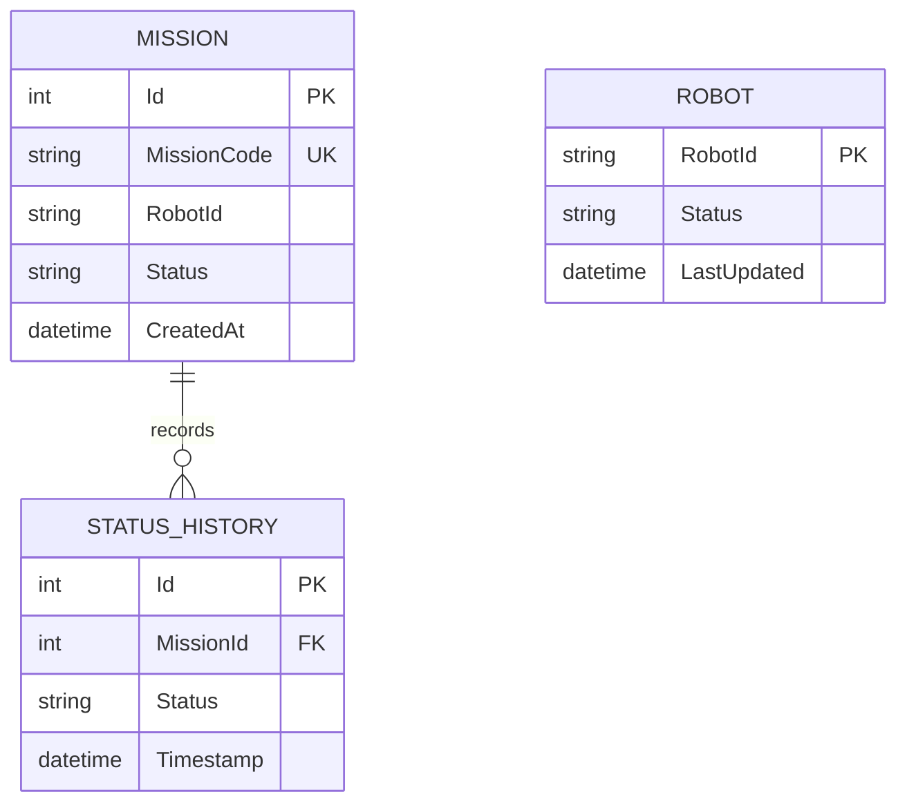

# KUKA AMR Middleware — projektová dokumentácia

## 1. Ciele a stav

### Súčasný stav
KUKA AMR Fleet Manager (KUKA FM) beží samostatne bez napojenia na okolité systémy. Obsluha musí zadávať a monitorovať misie priamo v KUKA UI.

### Cieľový stav
Middleware sprostredkuje riadenie a sledovanie misií pre fiktívny externý systém. Zjednodušuje a zjednocuje prístup k funkciám KUKA FM cez vlastné REST API a webové UI.

## 2. Požiadavky

### Funkcionálne požiadavky (FR)

| ID | Požiadavka |
| --- | --- |
| FR1 | Middleware umožní zadať novú misiu robotovi cez vlastný endpoint, ktorý interne zavolá `submitMission` na KUKA FM. |
| FR2 | Middleware umožní zrušiť rozbehnutú misiu cez vlastný endpoint, ktorý interne zavolá `cancelMission` na KUKA FM. |
| FR3 | Middleware periodicky pollingom zisťuje aktuálny stav aktívnych misií cez Query jobs API KUKA FM a ukladá ho do vlastnej databázy. |
| FR4 | Middleware periodicky zisťuje aktuálny stav robotov cez query API KUKA FM a ukladá ho do vlastnej databázy. |
| FR5 | Middleware uchováva históriu stavov jednotlivých misií pre reportovanie. |
| FR6 | Middleware poskytuje webové rozhranie so zoznamom misií a ich aktívnym/historickým stavom. |
| FR7 | Middleware poskytuje webové rozhranie so zoznamom robotov a ich aktuálnym stavom. |

### Nefunkcionálne požiadavky (NFR)

| ID | Požiadavka |
| --- | --- |
| NFR1 | Middleware je kontajnerizovaný a používa perzistentnú databázu. |
| NFR2 | Vlastné API middlewaru je chránené — neautorizovaný alebo neplatný request je odmietnutý. |
| NFR3 | Middleware overuje platnosť KUKA FM `Authorization` tokenu pri každom volaní na KUKA FM. |
| NFR4 | Middleware zapisuje štruktúrované logy o vlastnej činnosti a chybách. |
| NFR5 | Middleware je nasaditeľný cez CI/CD pipeline. |

## 3. Prípady použitia (use-case diagram)



| Use case | Aktér a cieľ | Hlavný scenár |
| --- | --- | --- |
| Správa misií | Operátor zadáva a sleduje misiu. | Vyberie robota, zadajú sa parametre/point pre misiu, middleware odošle požiadavku do KUKA FM a zobrazí uložený stav. |
| Zrušenie misie | Operátor zastaví aktívnu misiu. | Vyberie aktívnu misiu, middleware požiada KUKA FM o zrušenie a zaznamená stav `CANCEL_REQUESTED`. |
| História misií | Operátor preveruje priebeh a ukončené misie. | Otvorí misiu, načíta aktuálny stav a záznamy histórie. |
| Správa robotov | Operátor zisťuje dostupnosť robotov. | UI zobrazí zoznam robotov a ich posledný stav zo záznamov polling workeru. |

## 4. Procesný diagram / diagram aktivít

### Dispatch misie



### Polling stavu



## 5. Dátový model (ERD)



### Dátové entity

- Mission: hlavná entita misie, uložený `MissionCode`, `RobotId`, `Status`, `CreatedAt`
- StatusHistory: chronologická história stavov pre každú misiu
- Robot: posledný stav robota, ktorý sa aktualizuje polling workerom

## 6. Návrh view aplikácie

### Webové UI

Hlavná obrazovka poskytuje:
- vstup pre nastavenie `X-Api-Key`
- formulár pre dispatch novej misie
- zoznam aktivných misií
- zoznam robotov
- možnosť zrušiť misiu

```text
KUKA Middleware Control
------------------------------------------
API key: [*********]   [Save]

Dispatch mission
Org ID: [UNIVERSAL]
Robot ID: [R-01]
Mission type: [MOVE]
Target point: [A-02]
Mission goal: [Go to A-02]
Mission data JSON: [ ... ]
[Dispatch] [Reset]

Active missions
Mission Code   Robot   Status     Action
FM-1042        R-01    PENDING    [Cancel]

Robots
Robot ID  Status   Last updated
R-01      BUSY     09:46:10
R-02      AVAILABLE 09:46:10
```

### Wireframe návrh

```text
Missions | Robots
-----------------------------------------
[+ Mission]
-----------------------------------------
Code        Robot   Status       Created      Action
FM-1042     R-01    EXECUTING    09:42        Cancel
FM-1041     R-03    COMPLETED    09:12        History
FM-1040     R-02    WARNING      08:56        History
```

```text
New mission
Robot [R-01]      Mission type [MOVE]
Target point [A-02]
Goal [Go to A-02]
Mission data JSON [auto generated]
[Dispatch]
```

## 7. Technológie

- Backend: ASP.NET Core 8 Minimal API (C#)
- ORM: Entity Framework Core
- DB: PostgreSQL
- Frontend: jednoduchý web HTML + CSS + JavaScript
- Kontajnerizácia: Docker + docker-compose
- Autentifikácia: `X-Api-Key` pre vlastné API
- KUKA integrácia: raw HTTP client s `Authorization` tokenom

## 8. Akceptačné kritériá

- Je možné zadať novú misiu.
- Je možné zrušiť prebiehajúcu misiu.
- Je možné prezrieť stav prebiehajúcich a ukončených misií.
- Je možné prezrieť stav robotov.
- Prístup ku KUKA FM API je zabezpečený tokenom.
- Všetky operácie používateľa sú logované.
- Proces testovania a nasadenia je automatizovaný.
- Riešenie je dokumentované v projekte.

## Implementačný stav projektu

Projekt je v aktuálnej verzii implementovaný nasledovne:

- REST API pre dispatch a cancel missions
- poller na čítanie jobs a robot status z KUKA FM
- persistencia do PostgreSQL
- jednoduché webové UI dostupné na `http://localhost:8080/`
- API ochrana `X-Api-Key`
- testy pre API a UI route

## Záver

Toto riešenie splňuje základný business request pre middleware medzi KUKA FM a fiktívnym stavebným / výrobno-logistickým systémom. Backend aj frontend sú pripravené na ďalší rozvoj, napr. na rozšírenie o filterovanie, historické reporty, správu používateľov alebo CI/CD pipeline do produkčného prostredia.