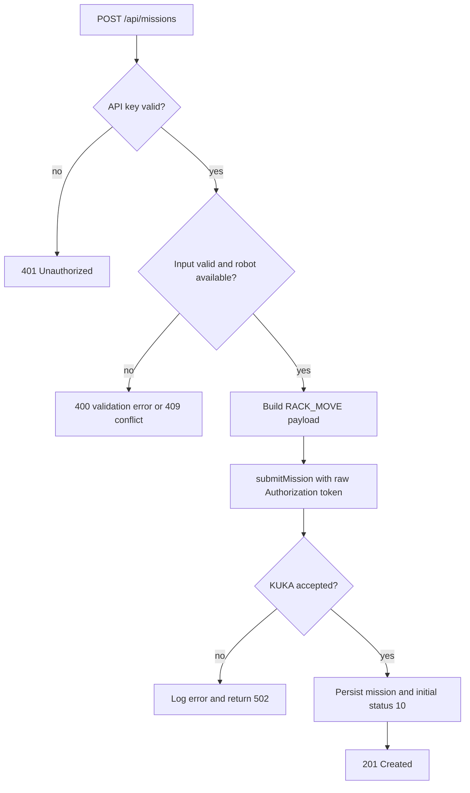
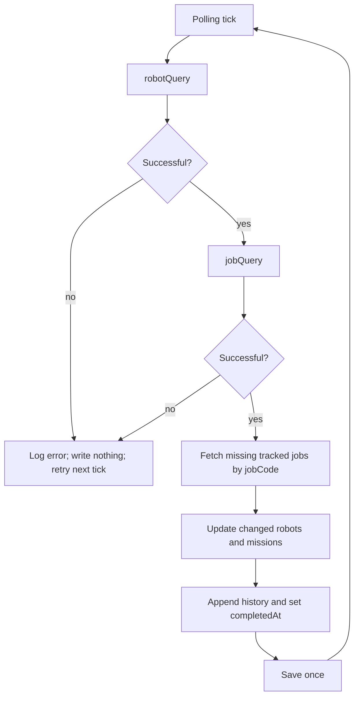
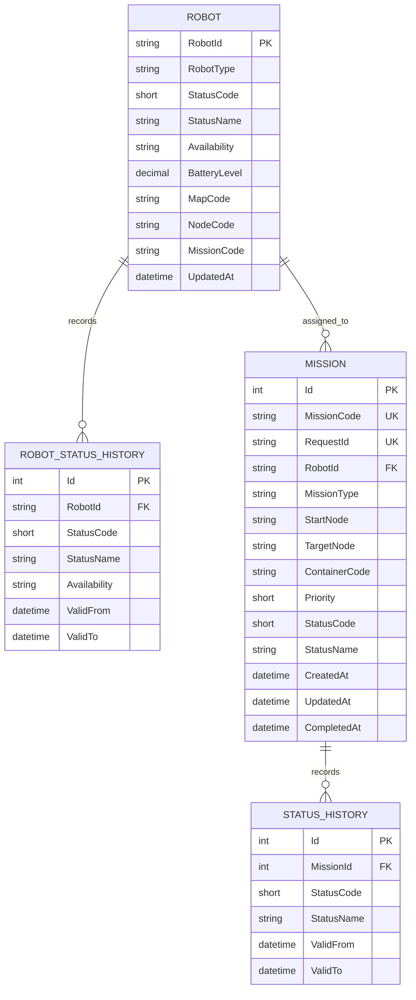

# KUKA AMR Middleware — špecifikácia a implementačný stav

## 1. Cieľ systému

KUKA AMR Fleet Manager (KUKA FM) riadi roboty, ale okolité systémy nemajú jednotné rozhranie na zadávanie a sledovanie misií. Middleware poskytuje chránené REST API a webové UI pre `RACK_MOVE`; KUKA FM zostáva autoritou pre vykonanie misie a stav robotov.

Riešenie je ASP.NET Core 8 Minimal API, EF Core, PostgreSQL a statické HTML/CSS/JavaScript. Jediný API kontajner obsluhuje REST API aj web UI. PostgreSQL a Seq bežia ako samostatné Docker Compose služby.

## 2. Požiadavky a trasovanie

| ID | Požiadavka | Implementácia |
| --- | --- | --- |
| FR1 | Dispatch misie cez middleware do `submitMission`. | `POST /api/missions`; validácia robota, uzlov, kontajnera a priority; payload `RACK_MOVE`. |
| FR2 | Cancel aktívnej misie cez KUKA FM. | `POST /api/missions/{missionCode}/cancel`; iba statusy 10, 20, 25, 28, 50; režim `FORCE`; KUKA chyba sa vracia ako 502. KUKA FM štandard API endpoint sa volá `missionCancel` (`/interfaces/api/amr/missionCancel`); pôvodné označenie `cancelMission` v ITS-1 treba čítať ako nepresné pomenovanie tej istej operácie. |
| FR3 | Polling a persistencia aktívnych misií. | Poller načíta robotov a joby, aktualizuje iba známe aktívne misie a pri chýbajúcom jobe vykoná query podľa job code. |
| FR4 | Polling a persistencia robotov. | `robotQuery` načítava všetkých robotov; ukladá typ, surový status, dostupnosť, batériu, mapu, uzol, misiu a čas aktualizácie. |
| FR5 | Uchovanie histórie misií. | Každá zmena statusu uzavrie predchádzajúci interval a vloží nový záznam s `validFrom`/`validTo`. |
| FR6 | UI pre aktívne, ukončené misie a históriu. | Filter All/Active/Finished, detail stavu a rozbaliteľná história v tabuľke. |
| FR7 | UI pre roboty a ich históriu. | Dostupnosť, surový KUKA stav, batéria, mapa, uzol, misia a rozbaliteľná história. |
| NFR1 | Kontajnerizácia a perzistentná databáza. | Multi-stage Dockerfile; PostgreSQL a Seq majú vlastné persistent volumes. |
| NFR2 | Ochrana vlastného API. | `X-Api-Key` pre aplikačné API; iba `/health` a `/api/health` sú verejné. |
| NFR3 | Token KUKA FM pri každom volaní. | `Authorization` obsahuje nakonfigurovaný raw token bez `Bearer`; token sa neloguje. |
| NFR4 | Štruktúrované logy. | JSON logy do konzoly a Seq; API operácie, dispatch/cancel aj výsledky KUKA volaní. |
| NFR5 | Automatizované CI/CD vrátane redeploy. | `azure-pipelines.yml` pri zmene `main` vykoná build/test/Docker build a po úspešnom validačnom stage automaticky nasadí Compose na self-hosted agenta; následne vykoná UI/health smoke test. Azure pipeline, variable group a online Docker agent musia byť nakonfigurované v Azure DevOps. |

## 3. Use cases

| Use case | Aktér a cieľ | Hlavný scenár |
| --- | --- | --- |
| UC1 — Dispatch mission | Operátor odošle misiu dostupnému robotovi. | Vyplní štartovací a cieľový uzol, kontajner a prioritu. Middleware validuje údaje, odošle `RACK_MOVE` a až po úspešnej odpovedi uloží misiu so statusom 10. |
| UC2 — Cancel mission | Operátor zruší aktívnu misiu. | UI vyžiada potvrdenie; middleware odmietne neznámu/ukončenú misiu a odošle `missionCancel` s `FORCE`. Konečný status sa uloží pri ďalšom pollingu. |
| UC3 — View missions | Operátor sleduje aktuálne aj ukončené misie. | UI filtruje All/Active/Finished a obnovuje údaje každú sekundu, keď je zapnuté automatické obnovenie. |
| UC4 — View mission history | Operátor preverí priebeh misie. | UI načíta statusy od najnovšieho; každý obsahuje čas začiatku a konca platnosti. |
| UC5 — Synchronize missions | Systém synchronizuje iba známe aktívne misie. | Po úspešnom `robotQuery` vykoná `jobQuery`, prípadne query jednotlivého chýbajúceho job code; pri chybe nič neuloží a skúsi ďalší tick. |
| UC6 — View robot status | Operátor sleduje dostupnosť a polohu robotov. | UI zobrazuje stav, typ, batériu, mapu, uzol, aktuálnu misiu a čas aktualizácie. |
| UC7 — View robot history | Operátor preverí predchádzajúce stavy robota. | UI zobrazí predchádzajúce stavy s intervalom platnosti; neznámy robot vráti 404. |
| UC8 — Synchronize robots | Systém pravidelne synchronizuje roboty. | Nové roboty vloží; zmenu stavu alebo prevádzkových údajov uloží do histórie a aktualizuje aktuálny záznam. |

## 4. Procesné toky

### Dispatch misie

### Synchronizácia

## 5. Dátový model

Statusy misií: `10 Created`, `20 Executing`, `25 Waiting`, `28 Cancelling`, `30 Completed`, `31 Cancelled`, `35 Manual completed`, `50 Warning`, `60 Startup error`. Aktívne sú `10`, `20`, `25`, `28`, `50`; ukončené misie sa už nepollujú.

Statusy robotov: `1 Departure`, `2 Offline`, `3 Idle`, `4 Executing`, `5 Charging`, `6 Updating`, `7 Abnormal`. Mapovanie dostupnosti: `3 → Available`; `1, 4, 5, 6 → Busy`; `2, 7 → Offline`. Neznámy kód sa považuje za chybu pollingu, nie za platný offline stav.

## 6. Návrh webového UI

Jedna dashboard stránka poskytuje:

- API key pre middleware a stav spojenia.
- Formulár `RACK_MOVE` s robotom z DB, štartovacím/cieľovým uzlom, kontajnerom a prioritou 1–99.
- Tabuľku misií s filtrom All/Active/Finished, detailmi, históriou a potvrdením FORCE cancel.
- Tabuľku robotov s availability, KUKA stavom, batériou, mapou, uzlom, misiou a históriou.
- Automatické obnovenie každú sekundu; používateľ ho môže vypnúť.

## 7. Technológie a spustenie

- Backend a statické UI: ASP.NET Core 8 Minimal API.
- ORM a migrácie: Entity Framework Core 8; PostgreSQL provider.
- Databáza: PostgreSQL 16, persistent volume `postgres_data`.
- Logovanie: Serilog JSON console + Seq, persistent volume `seq_data`.
- Kontajnery: Docker multi-stage build + Docker Compose.
- Vlastné API: `X-Api-Key`.
- KUKA FM: HTTP JSON API s raw `Authorization` tokenom.

Lokálny štart: skopírovať `.env.example` na `.env`, nastaviť tajné hodnoty a spustiť `docker compose up -d --build`. Produkčné CD používa Azure DevOps variable group `kuka-middleware-deploy`; heslá a tokeny musia byť secret variables. CD agent musí byť self-hosted, mať Docker Desktop v režime Linux containers a pool určený premennou `DOCKER_AGENT_POOL`.

## 8. Akceptačné kritériá a zostávajúce kroky

- [x] Dispatch RACK_MOVE s validáciou robota, uzlov, kontajnera a priority.
- [x] FORCE cancel iba aktívnej misie; 404/409 pre neznáme/neaktívne misie.
- [x] Zobrazenie a filtrovanie aktívnych a ukončených misií.
- [x] História misií aj robotov s intervalmi platnosti.
- [x] Polling aktualizuje roboty a iba známe aktívne misie; pri KUKA chybe neuloží čiastočný výsledok.
- [x] API key, KUKA token a štruktúrované logovanie bez zápisu tokenu do logov.
- [x] PostgreSQL/Seq v Docker Compose; EF migrácie a konverzia predchádzajúcej `EnsureCreated` schémy.
- [x] Azure DevOps pipeline definovaný: CI a Docker build; automatický Compose redeploy po úspešnom CI; post-deploy smoke check.
- [x] README a táto špecifikácia aktualizované.
- [ ] V Azure DevOps treba vytvoriť pipeline z `azure-pipelines.yml`, nakonfigurovať variable group, pool self-hosted agenta a branch policy pre PR validáciu; workspace nemá prístupové údaje na vykonanie týchto nastavení.
- [ ] Publikovať aktualizované požiadavky a opraviť odkaz na stránku `Testovanie a CI-CD` v Azure DevOps Wiki; Wiki vyžaduje prihlásenie.
